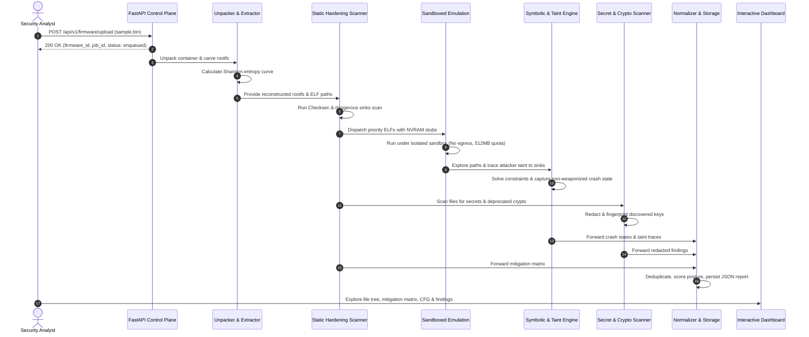

# System Architecture & High-Level Design
**Project Unit42-FirmwareX | Palo Alto Networks — Unit 42**
*Automated IoT / Embedded Firmware Attack Surface & Vulnerability Analysis Engine*

---

## 1. System Overview

Project **Unit42-FirmwareX** automates the end-to-end security analysis of open-source IoT and embedded Linux firmware images within strictly isolated, non-network-routed analysis sandboxes. The architecture pairs static binary inspection, cross-architecture emulation, bounded symbolic execution, taint tracking, and cryptographic auditing into a unified pipeline producing CWE-classified vulnerability reports.

```mermaid
flowchart LR
    Client["Client / Analyst"] -->|POST /firmware/upload| API["Control Plane (FastAPI)"]
    API -->|Enqueue Task| Queue["Worker Queue / Background Tasks"]
    Queue --> Unpacker["1. Unpacker & Extractor\n(Magic Carving + Entropy)"]
    Unpacker --> Inventory["Reconstructed Rootfs\n+ File Inventory"]
    Inventory --> StaticAudit["2. Static Hardening Audit\n(Checksec + Sinks)"]
    StaticAudit --> Emulation["3. Sandboxed Emulation\n(QEMU / Unicorn + NVRAM)"]
    Emulation --> Symbolic["4. Symbolic & Taint Analysis\n(Bounded Path Solver)"]
    StaticAudit --> Scanner["5. Secret & Crypto Scanner\n(100% Redacted)"]
    Symbolic --> Normalizer["6. Normalizer & Posture Evaluator"]
    Scanner --> Normalizer
    Normalizer --> Output["CWE-Classified Report (JSON)\n+ Interactive Dashboard"]
```

---

## 2. Component Architecture

The platform consists of seven decoupled, modular subsystems:

### 2.1 Firmware Ingestion & Control Plane (`firmwarex/api/`)
- **FastAPI REST Service**: Exposes asynchronous REST endpoints conforming to PRD Section 8.1.
- **Job Lifecycle Tracking**: Dispatches long-running jobs to sandboxed background worker tasks, tracking progress (0-100%) through structured stages.
- **Audit Logging**: Emits immutable OpenTelemetry-compatible JSONL spans (`data_storage/logs/{firmware_id}_audit.jsonl`).

### 2.2 Unpacker & Filesystem Extractor (`firmwarex/unpacker/`)
- **Container Detector (`detector.py`)**: Identifies multi-stage firmware wrappers including U-Boot `uImage`, Broadcom TRX, SquashFS (LE/BE/Alternate), CramFS, JFFS2, UBIFS, CPIO, POSIX TAR, GZIP, and standalone ELFs.
- **Entropy Analyzer (`entropy.py`)**: Calculates block-level Shannon entropy (0.0 to 8.0 bits/byte) to distinguish between compressed filesystems, encrypted payloads, and uncompressed code regions.
- **Safe Extractor (`extractor.py`)**: Carves embedded partitions, extracts filesystems, and enforces anti-zip-bomb quotas (`MAX_FILE_EXTRACTION_COUNT = 5000`, `MAX_FIRMWARE_SIZE_BYTES = 250 MB`) and directory traversal (`../`) mitigations.
- **Inventory Engine (`tree.py`)**: Recursively audits the reconstructed rootfs, recording paths, MIME types, file sizes, permissions, and cryptographic SHA-256 hashes.

### 2.3 Static Hardening Audit Engine (`firmwarex/audit/`)
- **ELF Inspector (`elf_parser.py`)**: Parses ELF32/ELF64 headers, endianness, target architecture (MIPS, MIPSEL, ARM, ARM64, x86, x86_64), imported symbols, and sections.
- **Checksec Auditor (`checksec.py`)**: Evaluates compiler exploit mitigations per binary:
  - **NX / DEP**: Inspects `PT_GNU_STACK` segments (`PF_X` flag).
  - **PIE / ASLR**: Inspects `ET_DYN` vs `ET_EXEC` headers and dynamic linker relocations.
  - **RELRO**: Checks `PT_GNU_RELRO` segments and `DT_BIND_NOW` flags (None / Partial / Full).
  - **Stack Canaries**: Scans for `__stack_chk_fail` and `__stack_chk_guard`.
  - **FORTIFY_SOURCE**: Scans for fortified C library wrappers (`__sprintf_chk`, `__strcpy_chk`).
  - **Stripped Status**: Checks presence of `.symtab`.
- **Dangerous Sinks Scanner (`dangerous_sinks.py`)**: Scans ELF import and symbol tables for high-risk C runtime routines (`strcpy`, `strcat`, `gets`, `sprintf`, `system`, `popen`, `memcpy`) mapped directly to CWE-120, CWE-134, CWE-78, and CWE-787.

### 2.4 Cross-Architecture Emulation & Sandbox (`firmwarex/emulation/`)
- **Isolated Sandbox (`sandbox.py`)**:
  - **Zero Network Egress**: Reroutes outbound proxy variables (`http_proxy`, `https_proxy`, `all_proxy`) to a non-routable dummy address (`127.0.0.1:9`), preventing untrusted binaries from establishing outbound connections.
  - **Quota Enforcement**: Monitors CPU usage, memory ceilings (default: 512 MB), and wall-clock execution limits (default: 120s) via `psutil`. Automatically terminates child processes breaching thresholds with SIGKILL (`-9`).
- **QEMU Orchestrator (`qemu_runner.py`)**: Integrates QEMU user-mode emulation (`qemu-mips`, `qemu-arm`, etc.) for target architectures.
- **Micro-Emulator (`unicorn_engine.py`)**: High-fidelity native CPU emulation fallback using Capstone disassembly to simulate basic block execution, register corruption, and memory boundaries without external hypervisor dependencies.
- **NVRAM Stubber (`nvram_stub.py`)**: Injects mock hardware configurations (`/etc/nvram.conf`, `/etc/default_nvram`) simulating standard router peripherals to prevent daemons from crashing on initialization.

### 2.5 Program Analysis, Symbolic Execution & Taint (`firmwarex/analysis/`)
- **Control Flow Graph Generator (`cfg.py`)**: Disassembles functions into basic blocks using Capstone, identifies branch targets, call targets, and entry points, and produces interactive graphs with highlighted taint nodes and dangerous sinks.
- **Taint Tracker (`taint_tracker.py`)**: Models data-flow propagation from attacker-controllable input sources (`http_param`, `nvram_var`, `cli_argument`, `network_socket`) to sensitive memory and command execution sinks.
- **Bounded Symbolic Engine (`symbolic_engine.py`)**: Explores program paths subject to strict budgets (`max_depth = 35`, `max_paths = 50`, `timeout = 30s`) to mitigate path explosion. Solves reachability constraints to discover buffer overflows.
- **Non-Weaponized Crash Reporter (`crash_reporter.py`)**: Captures diagnostic state (`fault_address`, `registers`, `overflow_offset`, `stack_hash`) for researcher triage, strictly enforcing a zero-weaponization policy.

### 2.6 Secret & Cryptographic Scanner (`firmwarex/scanner/`)
- **Secret Scanner (`secret_scanner.py`)**: Performs pattern and Shannon entropy analysis across all extracted files to detect AWS access keys, private RSA/EC keys, hardcoded passwords, and JWT tokens (CWE-798, CWE-259, CWE-321).
- **Redaction Engine (`redactor.py`)**: Guarantees **100% Redaction Coverage**. Raw plaintext secrets are masked (e.g. `AKIA************MPLE`) and fingerprinted with SHA-256 (`sha256:1a5d...`).
- **Crypto Scanner (`crypto_scanner.py`)**: Identifies deprecated hashing algorithms (MD5, SHA-1) and broken ciphers (DES, 3DES, RC4, ECB block cipher modes) mapped to CWE-328 and CWE-327.

### 2.7 Interactive Dashboard (`firmwarex/dashboard/`)
- Streamlit modern interface featuring:
  - Executive Posture Overview with dynamic 0-100 scoring.
  - Binary Mitigation Status Matrix (Checksec table sortable by risk).
  - Searchable Rootfs File-Tree Viewer.
  - Interactive CFG Visualizer with block disassembly and sink badges.
  - Filterable CWE Findings Log with diagnostic crash register snapshots.
  - Live Guardrails and Containment monitor.

---

## 3. Communication & Data Flow

---

## 4. Containment & Guardrails Architecture

The engine enforces strict defense-in-depth safety controls:
1. **Zero Outbound Network Egress**: The sandbox environment intercepts network requests via proxy dead-ends (`127.0.0.1:9`). No live devices or untrusted networks are ever contacted.
2. **Resource Quotas**: Every subprocess is managed via `psutil` wrappers. If execution exceeds 120s or 512 MB RAM, the process and all child threads are terminated immediately with exit code -9.
3. **100% Secret Redaction**: No discovered credential or key is ever written to reports or logs in plaintext.
4. **Analysis Only / Non-Weaponization**: The engine produces diagnostic crash registers, stack hashes, and virtual addresses. It contains no exploit generators, NOP sled builders, or shellcode constructors.
